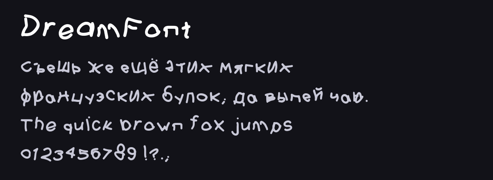

# DreamFont

<!-- Generated by tools/build_readme.py: edit meta.json / font.json instead. -->

**Автор:** [@lwwlt](https://t.me/lwwlt) · шрифт

Рисованный от руки. Кириллица, латиница и цифры.

**Файлы:** [font.json](font.json), [font.ttf](font.ttf), [screenshot.png](screenshot.png)

Установка: каталог плагинов → раздел «Шрифты», или AyuGram → Оформление → Сообщения → Каталог шрифтов. Файл проверяется по SHA-256 `b542c327288e7e4643287a0bbe6434640dab2c5a07bb290c6d45a86034ad9588`.
