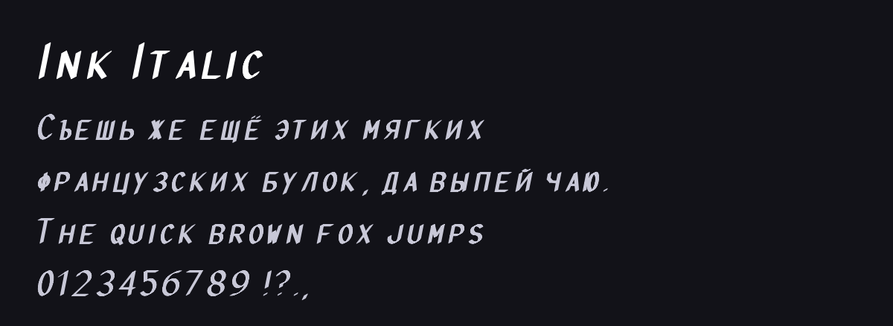

# Ink Italic

<!-- Generated by tools/build_readme.py: edit meta.json / font.json instead. -->

**Автор:** [@lwwlt](https://t.me/lwwlt) · шрифт

Курсив, как написанный чернилами. Кириллица, латиница и цифры.

**Файлы:** [font.json](font.json), [font.ttf](font.ttf), [screenshot.png](screenshot.png)

Установка: каталог плагинов → раздел «Шрифты», или AyuGram → Оформление → Сообщения → Каталог шрифтов. Файл проверяется по SHA-256 `e419ed88962e179eae7cdc5d18b8666826fa05110cda62ecbff9160cee2bb322`.
