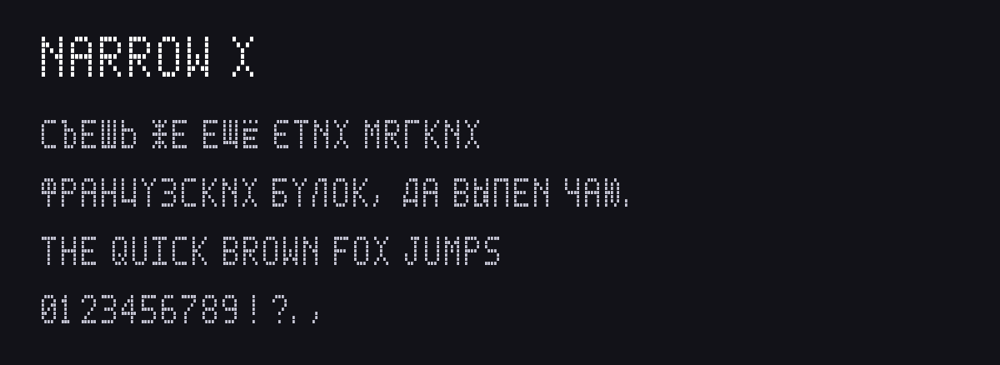

# NARROW X

<!-- Generated by tools/build_readme.py: edit meta.json / font.json instead. -->

**Автор:** [@lwwlt](https://t.me/lwwlt) · шрифт

Узкий высокий шрифт. Кириллица, латиница и цифры.

**Файлы:** [font.json](font.json), [font.ttf](font.ttf), [screenshot.png](screenshot.png)

Установка: каталог плагинов → раздел «Шрифты», или AyuGram → Оформление → Сообщения → Каталог шрифтов. Файл проверяется по SHA-256 `2e25d7beaec0dbb201ccad291398b5b545416e835c039ae944a9a60d53e8e574`.
