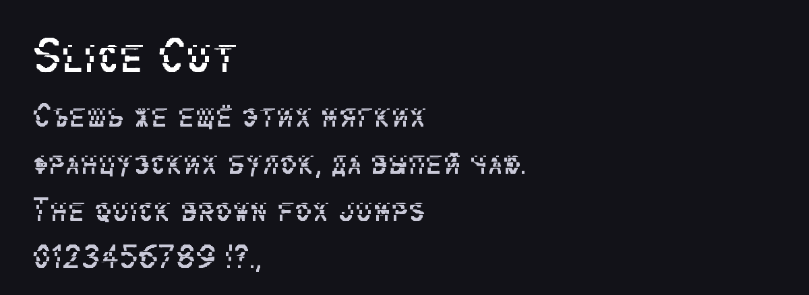

# Slice Cut

<!-- Generated by tools/build_readme.py: edit meta.json / font.json instead. -->

**Автор:** [@lwwlt](https://t.me/lwwlt) · шрифт

Рубленые буквы с косым срезом. Кириллица, латиница и цифры.

**Файлы:** [font.json](font.json), [font.ttf](font.ttf), [screenshot.png](screenshot.png)

Установка: каталог плагинов → раздел «Шрифты», или AyuGram → Оформление → Сообщения → Каталог шрифтов. Файл проверяется по SHA-256 `dce48c6c715af7b8cac428f7a3e5532baa04b3ee9e29c0a5f6d386d833042301`.
