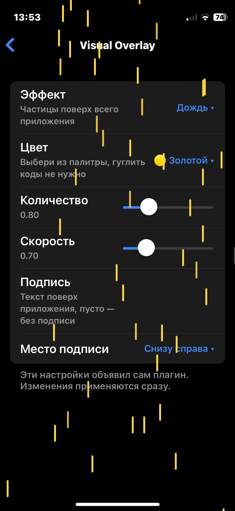

# Visual Overlay

<!-- Generated by tools/build_readme.py: edit meta.json / font.json instead. -->

**Автор:** [@gurodesc](https://t.me/gurodesc) · версия 1.2 · JavaScript · ✓ официальный

золотой дождь

**Файлы:** [meta.json](meta.json), [plugin.ayu.js](plugin.ayu.js), [screenshot.jpg](screenshot.jpg)

Установка: VoidGram → Плагины → значок сумки (каталог). Файл проверяется по SHA-256 `4967d90a3b4a6e473e7bdfb9ad08d2d996c5c65d367f1f750711ee0bcae996fc`.
